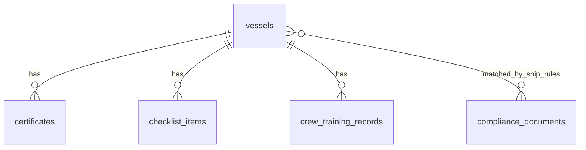

# Maritime SQL Agent

선박 운항 컴플라이언스 데이터를 자연어로 조회하는 **Text-to-SQL 에이전트**입니다.
선박 실무자(Captain, Chief Officer, Superintendent, DPA)가 SQL을 몰라도 증서 만료일과 PSC 점검 항목을 즉시 확인할 수 있게 하는 것이 목표입니다.

## 문제 정의

선박 운항 업무에서는 선박 제원, 증서 만료일, PSC 점검 항목, Crew Training 만료, 적용 Regulation을 함께 확인해야 합니다.

- PSC inspector — 만료된 certificate와 open checklist item을 먼저 보고 싶다
- Superintendent — 선박별 compliance risk가 높은 순서를 알고 싶다
- Chief Officer — 특정 LNG Carrier에 적용되는 Manual과 System Doc을 찾아야 한다

이 질문들이 모두 다중 JOIN과 날짜 연산을 요구해, 비개발자가 직접 조회하기 어렵습니다.

## 데이터 모델

PostgreSQL(Neon) 5개 테이블. 모든 테이블·컬럼에 `COMMENT`를 부여해 LLM이 스키마 의미를 읽을 수 있게 했습니다.

| 테이블 | 역할 | SQL 평가에서의 검증 지점 |
| --- | --- | --- |
| `vessels` | Ship Profile 기준 엔티티 | IMO lookup, fleet grouping |
| `certificates` | 증서 만료 관리 | expired/expiring 조회, risk score |
| `compliance_documents` | Regulation·Manual·System Doc 카탈로그 | 선박별 문서 매칭 |
| `checklist_items` | PSC/FSC/Vetting/Audit 준비 항목 | open item, completion rate |
| `crew_training_records` | STCW 및 직무 교육 이력 | training expiry, crew eligibility |



## 접근 방법 — 3단계 비교

단순히 동작하는 에이전트를 만드는 대신, **무엇이 정확도를 올리는지** 단계별로 비교했습니다.

1. **Baseline** — LlamaIndex `NLSQLTableQueryEngine` 기본 설정
2. **Advanced Prompt** — 도메인 규칙(선종·증서 종류·만료 기준) + Few-shot SQL 예제를 프롬프트에 주입
3. **ObjectIndex Retriever** — 테이블 설명을 `SQLTableSchema`로 제공하고, 질문별로 관련 테이블만 선택하게 구성

## 평가셋

10개 질문을 난이도별로 설계해 **어느 SQL 구문에서 모델이 실패하는지** 진단합니다.

| 난이도 | 문항 수 | 검증 대상 |
| --- | --- | --- |
| Easy | 3 | 단순 필터, 단일 테이블 조회 |
| Medium | 4 | 다중 JOIN, 집계, 날짜 연산 |
| Hard | 3 | 윈도우 함수, 다단계 CTE |

결과는 [`maritime_SQL_agent_text_to_sql_results.csv`](maritime_SQL_agent_text_to_sql_results.csv), 기대 SQL은 [`queries/evaluation_questions.sql`](queries/evaluation_questions.sql) 에 있습니다.

## 구조

```
docs/PROJECT_BRIEF.md          프로젝트 제안서 (도메인·사용자·테이블 설계)
docs/IMPLEMENTATION_PLAN.md    개발 및 검증 계획
docs/ENVIRONMENT.md            실행 환경 설정
sql/01_schema.sql              스키마 생성 (COMMENT 포함)
sql/02_seed.sql                seed data
sql/03_verify.sql              row count·FK·COMMENT 검증
queries/evaluation_questions.sql   평가 질문별 expected SQL
scripts/deploy_sql.py          NEON_DSN으로 SQL 적용
scripts/run_expected_queries.py    기대 SQL 일괄 실행
scripts/launch_gradio_ui.py    Gradio ChatInterface 데모
results/                       실행 결과
```

## 실행

```bash
export NEON_DSN="postgresql://..."
export OPENAI_API_KEY="sk-..."

python scripts/deploy_sql.py       # 스키마 + seed 적용
python scripts/run_expected_queries.py
python scripts/launch_gradio_ui.py # 데모 UI
```

Colab에서는 `maritime_sql_agent.ipynb` 를 위에서부터 실행하면 됩니다. 비밀값은 Colab Secrets(`NEON_DSN`, `OPENAI_API_KEY`)에서 읽습니다.

## 기술 스택

PostgreSQL(Neon) · LlamaIndex · OpenAI API · Gradio · Python

## 참고

seed data는 실제 운영 데이터가 아니라, 해사 업무 패턴을 참고해 만든 synthetic data입니다.
