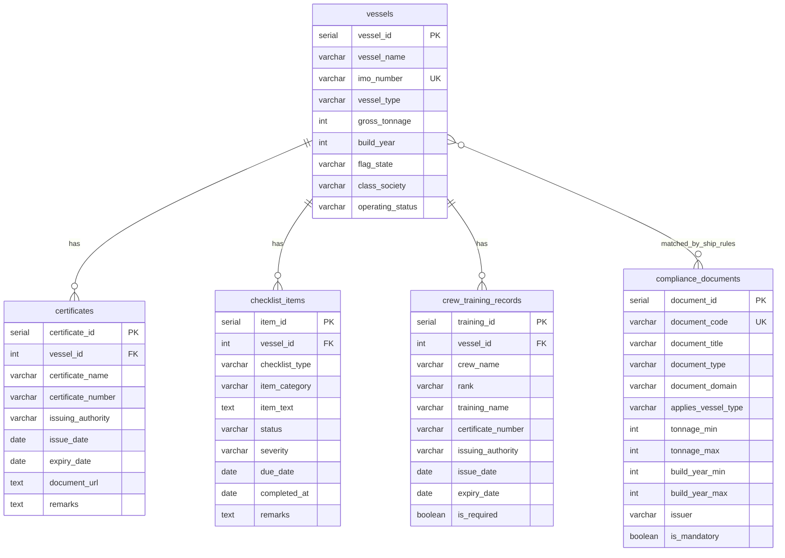

# maritime_SQL_agent 프로젝트 제안서

## 0. 프로젝트명

**maritime_SQL_agent**  
선박 운항 컴플라이언스 관리를 위한 Text-to-SQL 분석 에이전트

## 1. 도메인: 선박 운항 컴플라이언스 운영 데이터베이스

이번 프로젝트의 도메인은 선박 운항 컴플라이언스 운영 데이터베이스입니다. 선박 관리 회사나 선박 현장에서 실제로 관리하는 Ship Profile, Certificate expiry, PSC Checklist, Regulation·Manual·System Doc, Crew Training 정보를 PostgreSQL에 구조화하고, 자연어 질문을 SQL로 변환해 실무자가 곧바로 필요한 항목을 조회할 수 있게 하는 것이 목표입니다.

## 2. 대상 사용자

- Captain, Chief Officer, Chief Engineer 등 선박 실무자
- Superintendent, DPA, 선박 관리 회사의 Compliance 담당자
- PSC/FSC inspection을 준비하거나 수행하는 해사 감독관
- 선박 운항 데이터 기반 Text-to-SQL 에이전트를 평가하고 개선하는 개발자

## 3. 해결할 문제

선박 운항 업무에서는 선박 제원, 증서 만료일, PSC 점검 항목, Crew Training expiry, Regulation/Manual 적용 범위를 함께 확인해야 합니다. 예를 들어 PSC inspector는 만료된 certificate와 open checklist item을 먼저 보고 싶고, Superintendent는 선박별 compliance risk가 높은 순서를 알고 싶으며, Chief Officer는 특정 LNG Carrier에 적용되는 Manual과 System Doc을 찾아야 합니다.

질문 10개는 단순 예시가 아니라 Text-to-SQL 에이전트의 기준선 평가 세트입니다. Easy/Medium/Hard 질문을 골고루 섞어 두면, 모델이 단순 필터·JOIN·집계·윈도우 함수·다단계 CTE 중 어디에서 실패하는지 확인할 수 있습니다.

초기 데이터는 과제용 가상 데이터입니다. 실제 선박 운항 업무의 Ship Profile 조회, Certificate 만료 알림, PSC/FSC Checklist 관리, STCW Crew Training 이력 흐름을 참고해 실무 질문에 가까운 구조로 설계했습니다.

## 4. 테이블 설계

### 테이블 1: vessels

```sql
CREATE TABLE vessels (
    vessel_id        SERIAL PRIMARY KEY,
    vessel_name      VARCHAR(120) NOT NULL,
    imo_number       VARCHAR(20) NOT NULL UNIQUE,
    vessel_type      VARCHAR(80) NOT NULL,
    gross_tonnage    INT NOT NULL CHECK (gross_tonnage > 0),
    build_year       INT NOT NULL CHECK (build_year >= 1900),
    flag_state       VARCHAR(80) NOT NULL,
    class_society    VARCHAR(40),
    operating_status VARCHAR(20) NOT NULL CHECK (operating_status IN ('active', 'drydock', 'inactive'))
);

COMMENT ON TABLE vessels IS '관리 대상 선박의 기본 제원과 운항 상태';
COMMENT ON COLUMN vessels.vessel_id IS '선박 고유 식별자';
COMMENT ON COLUMN vessels.vessel_name IS '선박명';
COMMENT ON COLUMN vessels.imo_number IS 'IMO Number';
COMMENT ON COLUMN vessels.vessel_type IS '선종: LNG Carrier, Bulk Carrier, Oil Tanker 등';
COMMENT ON COLUMN vessels.gross_tonnage IS '총톤수 GT';
COMMENT ON COLUMN vessels.build_year IS '선박 건조 연도';
COMMENT ON COLUMN vessels.flag_state IS '기국';
COMMENT ON COLUMN vessels.class_society IS '선급: KR, DNV, ABS, LR 등';
COMMENT ON COLUMN vessels.operating_status IS '운항 상태: active, drydock, inactive';
```

### 테이블 2: certificates

```sql
CREATE TABLE certificates (
    certificate_id     SERIAL PRIMARY KEY,
    vessel_id          INT NOT NULL REFERENCES vessels(vessel_id),
    certificate_name   VARCHAR(160) NOT NULL,
    certificate_number VARCHAR(80),
    issuing_authority  VARCHAR(120),
    issue_date         DATE,
    expiry_date        DATE NOT NULL,
    document_url       TEXT,
    remarks            TEXT
);

COMMENT ON TABLE certificates IS '선박별 certificate와 만료일 관리 정보';
COMMENT ON COLUMN certificates.certificate_id IS 'Certificate 고유 식별자';
COMMENT ON COLUMN certificates.vessel_id IS 'Certificate가 연결된 선박 ID';
COMMENT ON COLUMN certificates.certificate_name IS 'Certificate 이름';
COMMENT ON COLUMN certificates.certificate_number IS 'Certificate 번호';
COMMENT ON COLUMN certificates.issuing_authority IS '발급 기관 또는 선급';
COMMENT ON COLUMN certificates.issue_date IS '발급일';
COMMENT ON COLUMN certificates.expiry_date IS '만료일';
COMMENT ON COLUMN certificates.document_url IS '스캔 PDF 또는 전자 문서 링크';
COMMENT ON COLUMN certificates.remarks IS '비고 또는 OCR 확인 메모';
```

### 테이블 3: compliance_documents

```sql
CREATE TABLE compliance_documents (
    document_id         SERIAL PRIMARY KEY,
    document_code       VARCHAR(80) NOT NULL UNIQUE,
    document_title      VARCHAR(220) NOT NULL,
    document_type       VARCHAR(40) NOT NULL CHECK (document_type IN ('Regulation', 'Manual', 'Checklist', 'System Doc', 'Manufacturer Manual')),
    document_domain     VARCHAR(50) NOT NULL,
    applies_vessel_type VARCHAR(80),
    tonnage_min         INT,
    tonnage_max         INT,
    build_year_min      INT,
    build_year_max      INT,
    issuer              VARCHAR(120),
    is_mandatory        BOOLEAN NOT NULL DEFAULT TRUE
);

COMMENT ON TABLE compliance_documents IS '선박별 적용 가능성을 판단할 Regulation, Manual, Checklist, System Doc 목록';
COMMENT ON COLUMN compliance_documents.document_id IS '근거 문서 고유 식별자';
COMMENT ON COLUMN compliance_documents.document_code IS '문서 코드 또는 약어';
COMMENT ON COLUMN compliance_documents.document_title IS '문서 제목';
COMMENT ON COLUMN compliance_documents.document_type IS '문서 유형: Regulation, Manual, Checklist, System Doc, Manufacturer Manual';
COMMENT ON COLUMN compliance_documents.document_domain IS '문서 업무 영역: Safety, Navigation, Cargo, Environment 등';
COMMENT ON COLUMN compliance_documents.applies_vessel_type IS '적용 선종. NULL이면 모든 선종에 적용';
COMMENT ON COLUMN compliance_documents.tonnage_min IS '적용 최소 GT. NULL이면 하한 없음';
COMMENT ON COLUMN compliance_documents.tonnage_max IS '적용 최대 GT. NULL이면 상한 없음';
COMMENT ON COLUMN compliance_documents.build_year_min IS '적용 최소 건조 연도. NULL이면 하한 없음';
COMMENT ON COLUMN compliance_documents.build_year_max IS '적용 최대 건조 연도. NULL이면 상한 없음';
COMMENT ON COLUMN compliance_documents.issuer IS '발행 기관, 회사, 제조사';
COMMENT ON COLUMN compliance_documents.is_mandatory IS '필수 적용 문서 여부';
```

### 테이블 4: checklist_items

```sql
CREATE TABLE checklist_items (
    item_id        SERIAL PRIMARY KEY,
    vessel_id      INT NOT NULL REFERENCES vessels(vessel_id),
    checklist_type VARCHAR(30) NOT NULL CHECK (checklist_type IN ('PSC', 'FSC', 'Vetting', 'Audit')),
    item_category  VARCHAR(60) NOT NULL,
    item_text      TEXT NOT NULL,
    status         VARCHAR(20) NOT NULL CHECK (status IN ('open', 'in_progress', 'completed', 'deferred')),
    severity       VARCHAR(20) NOT NULL CHECK (severity IN ('low', 'medium', 'high', 'critical')),
    due_date       DATE,
    completed_at   DATE,
    remarks        TEXT
);

COMMENT ON TABLE checklist_items IS 'PSC, FSC, Vetting, Audit 준비를 위한 선박별 체크리스트 항목';
COMMENT ON COLUMN checklist_items.item_id IS '체크리스트 항목 고유 식별자';
COMMENT ON COLUMN checklist_items.vessel_id IS '체크리스트가 연결된 선박 ID';
COMMENT ON COLUMN checklist_items.checklist_type IS '점검 유형: PSC, FSC, Vetting, Audit';
COMMENT ON COLUMN checklist_items.item_category IS '점검 카테고리: Bridge, Deck, Engine, Safety 등';
COMMENT ON COLUMN checklist_items.item_text IS '점검 항목 내용';
COMMENT ON COLUMN checklist_items.status IS '항목 처리 상태';
COMMENT ON COLUMN checklist_items.severity IS '미완료 시 중요도';
COMMENT ON COLUMN checklist_items.due_date IS '조치 기한';
COMMENT ON COLUMN checklist_items.completed_at IS '완료일';
COMMENT ON COLUMN checklist_items.remarks IS '점검 비고';
```

### 테이블 5: crew_training_records

```sql
CREATE TABLE crew_training_records (
    training_id        SERIAL PRIMARY KEY,
    vessel_id          INT NOT NULL REFERENCES vessels(vessel_id),
    crew_name          VARCHAR(120) NOT NULL,
    rank               VARCHAR(80) NOT NULL,
    training_name      VARCHAR(160) NOT NULL,
    certificate_number VARCHAR(80),
    issuing_authority  VARCHAR(120),
    issue_date         DATE NOT NULL,
    expiry_date        DATE,
    is_required        BOOLEAN NOT NULL DEFAULT TRUE
);

COMMENT ON TABLE crew_training_records IS '선원별 STCW 및 직무 교육 certificate 이력';
COMMENT ON COLUMN crew_training_records.training_id IS '교육 이력 고유 식별자';
COMMENT ON COLUMN crew_training_records.vessel_id IS '선원이 배정된 선박 ID';
COMMENT ON COLUMN crew_training_records.crew_name IS '선원 이름';
COMMENT ON COLUMN crew_training_records.rank IS '직급: Captain, Chief Officer, 2/O, Chief Engineer 등';
COMMENT ON COLUMN crew_training_records.training_name IS '교육 또는 certificate 이름';
COMMENT ON COLUMN crew_training_records.certificate_number IS '교육 certificate 번호';
COMMENT ON COLUMN crew_training_records.issuing_authority IS '교육 발급 기관';
COMMENT ON COLUMN crew_training_records.issue_date IS '교육 certificate 발급일';
COMMENT ON COLUMN crew_training_records.expiry_date IS '교육 certificate 만료일. NULL이면 만료 없음';
COMMENT ON COLUMN crew_training_records.is_required IS '승선 또는 직무 수행에 필수인 교육 여부';
```

### 선정 이유와 검증

| 테이블 | 선정 이유 | 관계 및 검증 |
|---|---|---|
| `vessels` | 모든 선박 운영 질문의 기준 엔티티입니다. 선종, GT, 건조연도, flag state에 따라 certificate 관리와 적용 문서가 달라지므로 가장 먼저 필요합니다. | PK는 `vessel_id`, 업무상 식별자는 `imo_number` UNIQUE입니다. 다른 운영 테이블이 이 테이블을 FK로 참조합니다. |
| `certificates` | Certificate expiry는 PSC detention risk와 직접 연결되는 핵심 업무입니다. Certificate 담당자와 Superintendent가 가장 자주 조회할 데이터입니다. | `vessel_id` FK로 선박에 연결됩니다. Q2, Q5, Q8, Q10에서 만료일 기반 조회와 risk score 계산에 사용됩니다. |
| `compliance_documents` | Regulation만으로는 부족해서 Manual, Checklist, System Doc, Manufacturer Manual까지 한 곳에서 관리해야 합니다. Ship-specific RAG처럼 선종, GT, 건조연도 기준으로 적용 문서를 찾기 위해 필요합니다. | 공통 문서 카탈로그라 특정 선박 FK를 두지 않고, `applies_vessel_type`, `tonnage_min/max`, `build_year_min/max` 규칙으로 `vessels`와 매칭합니다. Q7에서 이 규칙을 검증합니다. |
| `checklist_items` | PSC/FSC/Vetting/Audit 준비는 실제 선박 관리자가 open item과 completion rate를 확인하는 업무입니다. | `vessel_id` FK로 선박에 연결됩니다. Q3, Q6, Q8, Q10에서 미완료 항목, 완료율, critical/high action을 조회합니다. |
| `crew_training_records` | STCW 및 직무 교육 만료는 승선 적격성과 연결됩니다. Crewing officer가 expired/expiring training을 확인해야 하므로 별도 테이블이 필요합니다. | `vessel_id` FK로 선박에 연결됩니다. Q4, Q9, Q10에서 required training expiry와 action item을 검증합니다. |

## 5. 질문 10개

질문은 Text-to-SQL 평가용입니다. 선박 실무자가 실제로 물어볼 법한 자연어 질문으로 구성하고, 난이도별로 SQL 패턴을 다르게 섞었습니다.

[Easy] Q1: "IMO 번호 9876543인 선박의 기본 제원을 보여줘."

SQL:

```sql
SELECT
    vessel_name,
    vessel_type,
    gross_tonnage,
    build_year,
    flag_state,
    class_society,
    operating_status
FROM vessels
WHERE imo_number = '9876543';
```

기대 결과: 해당 IMO Number를 가진 선박의 기본 제원. 예상 행 수: 1행

[Easy] Q2: "2026년 5월 2일 기준으로 이미 만료됐거나 60일 이내 만료되는 certificate를 보여줘."

SQL:

```sql
SELECT
    v.vessel_name,
    c.certificate_name,
    c.expiry_date,
    c.expiry_date - DATE '2026-05-02' AS days_remaining,
    CASE
        WHEN c.expiry_date < DATE '2026-05-02' THEN 'expired'
        ELSE 'expiring'
    END AS cert_status
FROM certificates c
JOIN vessels v ON v.vessel_id = c.vessel_id
WHERE c.expiry_date <= DATE '2026-05-02' + INTERVAL '60 days'
ORDER BY c.expiry_date;
```

기대 결과: 만료 또는 60일 이내 만료 certificate와 남은 일수. 예상 행 수: 5행

[Easy] Q3: "아직 완료되지 않은 high 또는 critical PSC checklist item을 심각도 순으로 보여줘."

SQL:

```sql
SELECT
    v.vessel_name,
    ci.item_category,
    ci.item_text,
    ci.severity,
    ci.due_date
FROM checklist_items ci
JOIN vessels v ON v.vessel_id = ci.vessel_id
WHERE ci.checklist_type = 'PSC'
  AND ci.status <> 'completed'
  AND ci.severity IN ('high', 'critical')
ORDER BY
    CASE ci.severity WHEN 'critical' THEN 1 WHEN 'high' THEN 2 ELSE 3 END,
    ci.due_date;
```

기대 결과: 미완료 high/critical PSC 항목 목록. 예상 행 수: 4행

[Medium] Q4: "이미 만료된 required crew training certificate 목록을 알려줘."

SQL:

```sql
SELECT
    v.vessel_name,
    ctr.crew_name,
    ctr.rank,
    ctr.training_name,
    ctr.expiry_date
FROM crew_training_records ctr
JOIN vessels v ON v.vessel_id = ctr.vessel_id
WHERE ctr.is_required = TRUE
  AND ctr.expiry_date < DATE '2026-05-02'
ORDER BY ctr.expiry_date;
```

기대 결과: 승선 또는 직무 수행에 필요한 교육 중 이미 만료된 항목. 예상 행 수: 2행

[Medium] Q5: "선박별로 expired certificate와 90일 이내 만료 예정 certificate 개수를 표로 정리해줘."

SQL:

```sql
SELECT
    v.vessel_name,
    COUNT(*) FILTER (WHERE c.expiry_date < DATE '2026-05-02') AS expired_count,
    COUNT(*) FILTER (
        WHERE c.expiry_date >= DATE '2026-05-02'
          AND c.expiry_date <= DATE '2026-05-02' + INTERVAL '90 days'
    ) AS expiring_90d_count
FROM vessels v
LEFT JOIN certificates c ON c.vessel_id = v.vessel_id
GROUP BY v.vessel_id, v.vessel_name
ORDER BY expired_count DESC, expiring_90d_count DESC, v.vessel_name;
```

기대 결과: 선박별 expired/expiring certificate 개수. 예상 행 수: briefing sample 기준 5행, 전체 seed DB 기준 50행

[Medium] Q6: "선박별 PSC checklist completion rate를 비교해줘."

SQL:

```sql
SELECT
    v.vessel_name,
    COUNT(ci.item_id) AS total_items,
    COUNT(ci.item_id) FILTER (WHERE ci.status = 'completed') AS completed_items,
    ROUND(
        100.0 * COUNT(ci.item_id) FILTER (WHERE ci.status = 'completed')
        / NULLIF(COUNT(ci.item_id), 0),
        2
    ) AS completion_pct
FROM vessels v
JOIN checklist_items ci ON ci.vessel_id = v.vessel_id
WHERE ci.checklist_type = 'PSC'
GROUP BY v.vessel_id, v.vessel_name
ORDER BY completion_pct ASC, v.vessel_name;
```

기대 결과: 선박별 PSC checklist 전체 항목, 완료 항목, 완료율. 예상 행 수: briefing sample 기준 5행, 전체 seed DB 기준 50행

[Medium] Q7: "M/V Ocean Aurora에 적용되는 Regulation, Manual, System Doc을 선박 제원 기준으로 찾아줘."

SQL:

```sql
SELECT
    v.vessel_name,
    d.document_code,
    d.document_title,
    d.document_type,
    d.document_domain,
    d.is_mandatory
FROM vessels v
JOIN compliance_documents d
    ON (d.applies_vessel_type IS NULL OR d.applies_vessel_type = v.vessel_type)
   AND (d.tonnage_min IS NULL OR d.tonnage_min <= v.gross_tonnage)
   AND (d.tonnage_max IS NULL OR d.tonnage_max >= v.gross_tonnage)
   AND (d.build_year_min IS NULL OR d.build_year_min <= v.build_year)
   AND (d.build_year_max IS NULL OR d.build_year_max >= v.build_year)
WHERE v.vessel_name = 'M/V Ocean Aurora'
ORDER BY d.document_domain, d.document_type, d.document_code;
```

기대 결과: 해당 LNG Carrier의 선종, GT, 건조 연도에 적용되는 근거 문서. 예상 행 수: 9행

[Hard] Q8: "fleet 전체에서 compliance risk가 높은 선박 순위를 보여줘. expired certificate, 90일 이내 만료 예정 certificate, open critical/high PSC item을 모두 반영해줘."

SQL:

```sql
WITH cert_risk AS (
    SELECT
        vessel_id,
        COUNT(*) FILTER (WHERE expiry_date < DATE '2026-05-02') AS expired_cert_count,
        COUNT(*) FILTER (
            WHERE expiry_date >= DATE '2026-05-02'
              AND expiry_date <= DATE '2026-05-02' + INTERVAL '90 days'
        ) AS expiring_cert_count
    FROM certificates
    GROUP BY vessel_id
),
checklist_risk AS (
    SELECT
        vessel_id,
        COUNT(*) FILTER (WHERE status <> 'completed' AND severity = 'critical') AS open_critical_count,
        COUNT(*) FILTER (WHERE status <> 'completed' AND severity = 'high') AS open_high_count
    FROM checklist_items
    WHERE checklist_type = 'PSC'
    GROUP BY vessel_id
),
scored AS (
    SELECT
        v.vessel_name,
        COALESCE(cr.expired_cert_count, 0) AS expired_cert_count,
        COALESCE(cr.expiring_cert_count, 0) AS expiring_cert_count,
        COALESCE(ch.open_critical_count, 0) AS open_critical_count,
        COALESCE(ch.open_high_count, 0) AS open_high_count,
        COALESCE(cr.expired_cert_count, 0) * 3
          + COALESCE(cr.expiring_cert_count, 0) * 2
          + COALESCE(ch.open_critical_count, 0) * 3
          + COALESCE(ch.open_high_count, 0) * 2 AS risk_score
    FROM vessels v
    LEFT JOIN cert_risk cr ON cr.vessel_id = v.vessel_id
    LEFT JOIN checklist_risk ch ON ch.vessel_id = v.vessel_id
)
SELECT
    vessel_name,
    expired_cert_count,
    expiring_cert_count,
    open_critical_count,
    open_high_count,
    risk_score,
    RANK() OVER (ORDER BY risk_score DESC) AS risk_rank
FROM scored
ORDER BY risk_rank, vessel_name;
```

기대 결과: fleet 선박별 compliance risk score와 순위. 예상 행 수: briefing sample 기준 5행, 전체 seed DB 기준 50행

[Hard] Q9: "required training이 만료됐거나 30일 이내 만료되는 crew를 선박별 위험도 순으로 정리해줘."

SQL:

```sql
WITH training_status AS (
    SELECT
        v.vessel_name,
        ctr.crew_name,
        ctr.rank,
        ctr.training_name,
        ctr.expiry_date,
        CASE
            WHEN ctr.expiry_date < DATE '2026-05-02' THEN 'expired'
            WHEN ctr.expiry_date <= DATE '2026-05-02' + INTERVAL '30 days' THEN 'expiring_30d'
            ELSE 'valid'
        END AS training_status
    FROM crew_training_records ctr
    JOIN vessels v ON v.vessel_id = ctr.vessel_id
    WHERE ctr.is_required = TRUE
      AND ctr.expiry_date IS NOT NULL
),
at_risk AS (
    SELECT *
    FROM training_status
    WHERE training_status IN ('expired', 'expiring_30d')
)
SELECT
    vessel_name,
    crew_name,
    rank,
    training_name,
    expiry_date,
    training_status,
    RANK() OVER (
        PARTITION BY vessel_name
        ORDER BY
            CASE training_status WHEN 'expired' THEN 1 ELSE 2 END,
            expiry_date
    ) AS vessel_risk_rank
FROM at_risk
ORDER BY
    CASE training_status WHEN 'expired' THEN 1 ELSE 2 END,
    expiry_date,
    vessel_name,
    crew_name;
```

기대 결과: 이미 만료됐거나 30일 이내 만료되는 required training certificate 및 선박별 위험도 순위. 예상 행 수: 6행

[Hard] Q10: "선박별로 지금 당장 조치해야 할 action item을 하나씩 보여줘."

SQL:

```sql
WITH action_items AS (
    SELECT
        v.vessel_id,
        v.vessel_name,
        'expired_certificate' AS action_type,
        c.certificate_name AS action_detail,
        c.expiry_date AS due_date,
        4 AS priority_score
    FROM certificates c
    JOIN vessels v ON v.vessel_id = c.vessel_id
    WHERE c.expiry_date < DATE '2026-05-02'

    UNION ALL

    SELECT
        v.vessel_id,
        v.vessel_name,
        'critical_psc_item' AS action_type,
        ci.item_text AS action_detail,
        ci.due_date,
        CASE ci.severity WHEN 'critical' THEN 4 WHEN 'high' THEN 3 ELSE 2 END AS priority_score
    FROM checklist_items ci
    JOIN vessels v ON v.vessel_id = ci.vessel_id
    WHERE ci.checklist_type = 'PSC'
      AND ci.status <> 'completed'
      AND ci.severity IN ('critical', 'high')

    UNION ALL

    SELECT
        v.vessel_id,
        v.vessel_name,
        'crew_training_expiry' AS action_type,
        ctr.crew_name || ' - ' || ctr.training_name AS action_detail,
        ctr.expiry_date AS due_date,
        CASE
            WHEN ctr.expiry_date < DATE '2026-05-02' THEN 4
            ELSE 2
        END AS priority_score
    FROM crew_training_records ctr
    JOIN vessels v ON v.vessel_id = ctr.vessel_id
    WHERE ctr.is_required = TRUE
      AND ctr.expiry_date <= DATE '2026-05-02' + INTERVAL '30 days'
),
ranked AS (
    SELECT
        *,
        ROW_NUMBER() OVER (
            PARTITION BY vessel_id
            ORDER BY priority_score DESC, due_date ASC
        ) AS rn
    FROM action_items
)
SELECT
    vessel_name,
    action_type,
    action_detail,
    due_date,
    priority_score
FROM ranked
WHERE rn = 1
ORDER BY priority_score DESC, due_date ASC, vessel_name;
```

기대 결과: 각 선박에서 가장 먼저 처리해야 하는 certificate, PSC item, crew training action. 예상 행 수: 5행

## 6. ERD (Mermaid)

`vessels`와 `compliance_documents`의 관계는 물리적 FK가 아니라 선종, GT, 건조연도 조건으로 매칭되는 논리적 관계입니다. 나머지 운영 테이블은 모두 `vessel_id` FK로 `vessels`에 연결됩니다.



## 7. 데이터 샘플

### vessels

| vessel_name | imo_number | vessel_type | gross_tonnage | build_year | flag_state | class_society | operating_status |
|---|---|---|---:|---:|---|---|---|
| M/V Ocean Aurora | 9876543 | LNG Carrier | 116000 | 2018 | Marshall Islands | DNV | active |
| M/V Pacific Trader | 9765432 | Bulk Carrier | 45200 | 2012 | Panama | KR | active |
| M/V Hanseatic Star | 9654321 | Container Ship | 74000 | 2020 | Liberia | ABS | active |
| M/T Blue Horizon | 9543210 | Oil Tanker | 58000 | 2015 | Singapore | LR | active |
| M/V Coastal Hope | 9432109 | General Cargo | 8500 | 2008 | Republic of Korea | KR | drydock |

### certificates

| vessel_name | certificate_name | certificate_number | issuing_authority | issue_date | expiry_date | remarks |
|---|---|---|---|---|---|---|
| M/V Ocean Aurora | Cargo Ship Safety Equipment Certificate | SE-2025-001 | DNV | 2025-05-26 | 2026-05-25 | renewal survey booked |
| M/V Ocean Aurora | International Oil Pollution Prevention Certificate | IOPP-2025-011 | DNV | 2025-01-15 | 2027-01-15 | valid |
| M/V Pacific Trader | Cargo Ship Safety Construction Certificate | SC-2021-009 | KR | 2021-04-20 | 2026-04-20 | expired, urgent renewal |
| M/V Pacific Trader | International Load Line Certificate | LL-2021-009 | KR | 2021-07-15 | 2026-07-15 | renewal window open |
| M/V Hanseatic Star | Cargo Ship Safety Radio Certificate | SR-2025-077 | ABS | 2025-06-21 | 2026-06-20 | GMDSS inspection required |
| M/V Hanseatic Star | International Tonnage Certificate | ITC-2020-014 | ABS | 2020-03-01 | 2030-03-01 | valid |
| M/T Blue Horizon | International Oil Pollution Prevention Certificate | IOPP-2021-041 | LR | 2021-05-30 | 2026-05-30 | annual survey pending |
| M/T Blue Horizon | Classification Certificate | CLASS-2021-041 | LR | 2021-10-01 | 2026-10-01 | valid |
| M/V Coastal Hope | Cargo Ship Safety Equipment Certificate | SE-2021-088 | KR | 2021-05-10 | 2026-05-10 | drydock renewal planned |
| M/V Coastal Hope | Certificate of Registry | REG-2023-088 | Korea Register | 2023-01-01 | 2028-01-01 | valid |

### compliance_documents

| document_code | document_title | document_type | document_domain | applies_vessel_type | tonnage_min | tonnage_max | build_year_min | build_year_max | issuer | is_mandatory |
|---|---|---|---|---|---:|---:|---:|---:|---|---|
| SOLAS-III | SOLAS Chapter III Life-Saving Appliances | Regulation | Safety | NULL | NULL | NULL | NULL | NULL | IMO | true |
| SOLAS-V | SOLAS Chapter V Safety of Navigation | Regulation | Navigation | NULL | NULL | NULL | NULL | NULL | IMO | true |
| MARPOL-I | MARPOL Annex I Oil Pollution Prevention | Regulation | Environment | Oil Tanker | NULL | NULL | NULL | NULL | IMO | true |
| MARPOL-I-LNG | MARPOL Annex I Machinery Space Bilge Requirements | Regulation | Environment | LNG Carrier | NULL | NULL | NULL | NULL | IMO | true |
| ISM-CODE | International Safety Management Code | Regulation | Management | NULL | NULL | NULL | NULL | NULL | IMO | true |
| STCW-A-II | STCW Deck Officer Competence Standards | Regulation | Crew | NULL | NULL | NULL | NULL | NULL | IMO | true |
| PSC-GENERAL | PSC Pre-Inspection Checklist | Checklist | Inspection | NULL | 500 | NULL | NULL | NULL | Shipping Company | true |
| LNG-CARGO-MANUAL | LNG Carrier Cargo Operation Manual | Manual | Cargo | LNG Carrier | NULL | NULL | NULL | NULL | Shipping Company | true |
| CARGO-SYSTEM-DOC | LNG Cargo Handling System Doc | System Doc | Cargo | LNG Carrier | NULL | NULL | 2010 | NULL | Shipyard | false |
| PMS-ENGINE-MANUAL | Engine PMS Manufacturer Manual | Manufacturer Manual | Engineering | NULL | NULL | NULL | NULL | NULL | Equipment Maker | false |

### checklist_items

| vessel_name | checklist_type | item_category | item_text | status | severity | due_date | completed_at |
|---|---|---|---|---|---|---|---|
| M/V Ocean Aurora | PSC | Safety | Lifeboat weekly test record verified | completed | high | 2026-05-01 | 2026-05-01 |
| M/V Ocean Aurora | PSC | Cargo | Cargo ESD trip test evidence prepared | open | high | 2026-05-08 | NULL |
| M/V Ocean Aurora | PSC | Safety | Fire door inspection log updated | in_progress | medium | 2026-05-06 | NULL |
| M/V Pacific Trader | PSC | Deck | Hatch cover condition verified | open | critical | 2026-05-05 | NULL |
| M/V Pacific Trader | PSC | Navigation | Charts and publications corrected | completed | medium | 2026-05-02 | 2026-05-02 |
| M/V Hanseatic Star | PSC | Radio | GMDSS logbook checked | completed | medium | 2026-05-02 | 2026-05-02 |
| M/V Hanseatic Star | PSC | Safety | Fire drill record signed by Master | open | high | 2026-05-12 | NULL |
| M/T Blue Horizon | PSC | Environment | SOPEP drill evidence prepared | open | medium | 2026-05-07 | NULL |
| M/T Blue Horizon | PSC | Environment | Oil Record Book entries reviewed | completed | high | 2026-05-01 | 2026-05-01 |
| M/V Coastal Hope | PSC | Safety | Muster list updated after crew change | open | high | 2026-05-03 | NULL |

### crew_training_records

| vessel_name | crew_name | rank | training_name | certificate_number | issuing_authority | issue_date | expiry_date | is_required |
|---|---|---|---|---|---|---|---|---|
| M/V Ocean Aurora | Kim Minjun | Captain | Advanced Fire Fighting | AFF-2024-001 | Korea Maritime Training Center | 2024-02-01 | 2027-02-01 | true |
| M/V Ocean Aurora | Maria Santos | Chief Officer | Advanced Cargo Operations | ACO-2021-014 | SIGTTO Training Center | 2021-05-20 | 2026-05-20 | true |
| M/V Ocean Aurora | Lee Jisoo | 2/O | ECDIS Generic Training | ECDIS-2021-019 | KR Academy | 2021-04-30 | 2026-04-30 | true |
| M/V Pacific Trader | Ahmed Khan | Chief Engineer | Basic Safety Training | BST-2021-055 | Maritime Academy | 2021-09-01 | 2026-09-01 | true |
| M/V Pacific Trader | Ravi Singh | Bosun | Enclosed Space Entry | ESE-2021-078 | Maritime Academy | 2021-05-15 | 2026-05-15 | true |
| M/V Hanseatic Star | Zhang Wei | 2/O | GMDSS GOC | GMDSS-2021-120 | Radio School | 2021-06-10 | 2026-06-10 | true |
| M/V Hanseatic Star | Jose Santos | AB | Basic Safety Training | BST-2020-099 | Maritime Academy | 2020-12-31 | 2025-12-31 | true |
| M/T Blue Horizon | Park Hyun | Chief Officer | Oil Tanker Advanced Training | OTA-2021-041 | Tanker Training Center | 2021-05-28 | 2026-05-28 | true |
| M/T Blue Horizon | Chen Li | 3/E | Advanced Fire Fighting | AFF-2025-022 | Maritime Academy | 2025-03-01 | 2028-03-01 | true |
| M/V Coastal Hope | Choi Ara | Master | Medical Care | MED-2021-033 | Maritime Medical Institute | 2021-05-05 | 2026-05-05 | true |
